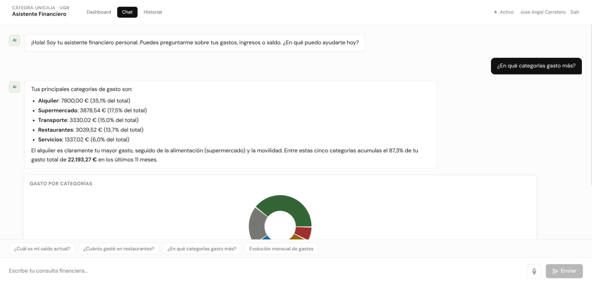
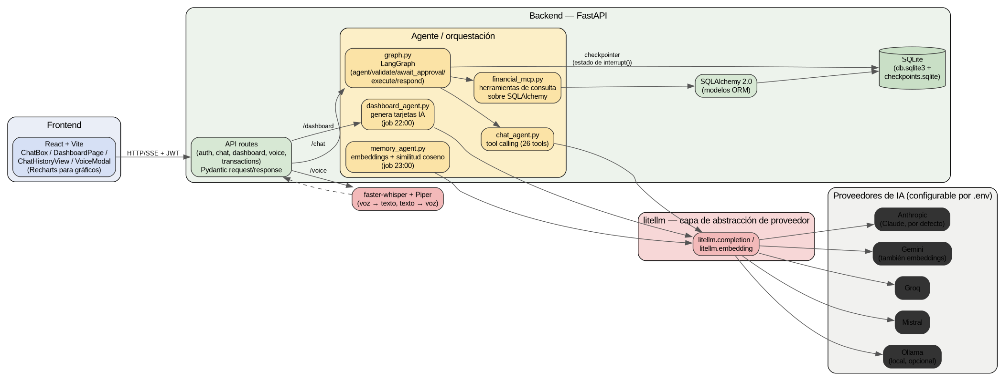

# 💬 Habla con tu dinero

> Un asistente financiero al que le hablas en lenguaje natural — y que nunca mueve
> un euro sin que tú lo apruebes.

Proyecto desarrollado para el reto de la **Cátedra Unicaja · Universidad de
Granada**, por **Jose Angel Carretero Montes** (Ingeniería Informática + ADE, UGR).
Más info sobre el reto: https://uni-ugr.web.app/reto.html



## Qué hace

- 💬 **Chat financiero con IA** — preguntas en lenguaje natural sobre tus
  movimientos, gastos por categoría, inversiones... con gráficos dinámicos en la
  respuesta.
- ✅ **Operaciones con aprobación humana** — Bizum e inversiones se *proponen* por
  IA pero se *validan* y *ejecutan* con código determinista, solo tras tu
  confirmación explícita. El LLM nunca toca la base de datos directamente.
- 📊 **Dashboard proactivo** — cada noche, un job genera tarjetas personalizadas
  (avisos de gasto, oportunidades, progreso de metas) sin que tengas que pedirlas.
- 🧠 **Memoria de usuario** — un RAG casero que aprende preferencias de tus
  conversaciones pasadas para personalizar futuras respuestas.
- 🎙️ **Modo voz** — habla con el asistente; transcripción y síntesis 100% locales
  (faster-whisper + Piper), sin APIs de pago de por medio.
- 🕑 **Historial de conversaciones** — retoma cualquier charla anterior, agrupada
  por día.

## Stack

**Backend:** FastAPI · LangGraph · litellm (Claude / Gemini / Groq / Mistral /
Ollama) · SQLAlchemy 2.0 · SQLite · JWT · Pydantic v2
**Frontend:** React · Vite · Recharts
**Voz:** faster-whisper · Piper TTS
**Infra:** Docker Compose

## Arquitectura



El LLM decide *qué* hacer vía tool calling; un grafo de LangGraph separa esa
decisión de la parte crítica (validar fondos, pedir aprobación, ejecutar), que es
código determinista y testeado — nunca el modelo directamente. Detalle completo en
[`docs/README.md`](docs/README.md).

## Arrancarlo

```bash
git clone https://github.com/0xjoseangel/reto-unicaja.git
cd reto-unicaja
cp backend/.env.example backend/.env   # rellena al menos una API key
docker compose up --build
docker compose exec backend python seed.py   # usuarios y datos de prueba
```

- Frontend: http://localhost:3000
- Backend: http://localhost:8000/docs

Detalle completo de arranque (con y sin Docker): [`docs/DOCKER.md`](docs/DOCKER.md).
Usuarios de prueba y qué probar con cada uno: [`docs/usuarios-prueba.md`](docs/usuarios-prueba.md).

## Documentación

- 📘 [**Documentación técnica completa**](docs/README.md) — capítulo a capítulo:
  modelo de datos, agente de IA, grafo de LangGraph, dashboard, memoria, voz...
- 📄 [**Memoria para el jurado**](docs/memoria.pdf) — resumen breve con
  arquitectura, modelo de datos y el porqué del diseño.

## Contexto académico

Proyecto presentado al reto propuesto por la Cátedra Unicaja en colaboración con la
Universidad de Granada. Autor: Jose Angel Carretero Montes.
