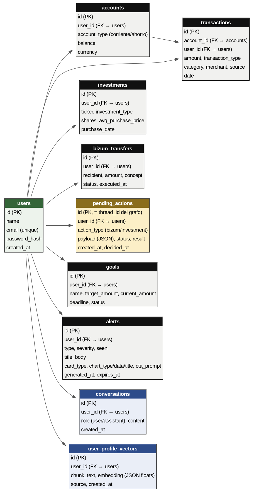
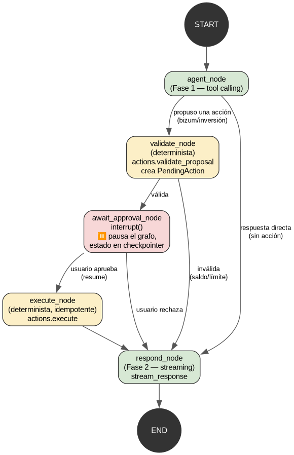

# 1. Qué es el proyecto

**"Habla con tu dinero"** es un asistente financiero conversacional: el usuario
escribe en lenguaje natural ("¿cuánto gasté en restaurantes este mes?", "manda 30€
a María") y la aplicación responde con datos de su cuenta, gráficos dinámicos y,
cuando la petición implica mover dinero, una propuesta que el propio usuario debe
aprobar antes de que se ejecute. El objetivo es explorar cómo dar a un LLM
capacidad de actuar sobre datos financieros reales sin perder el control ni la
seguridad que exige ese dominio.

# 2. Subsistemas, a grandes rasgos

- **Chat financiero con IA.** LangGraph decide, mediante *tool calling*, qué
  consultas hacer sobre la base de datos del usuario y redacta la respuesta en
  streaming.
- **Operaciones validadas por código, no por el LLM.** Para Bizum o inversión, el
  modelo solo *propone*; un paso determinista valida fondos y límites, y el usuario
  aprueba o rechaza antes de que nada se ejecute.
- **Dashboard proactivo.** Cada noche, un job genera tarjetas personalizadas (avisos
  de gasto, oportunidades de inversión, progreso de metas) sin que el usuario las pida.
- **Memoria de usuario (RAG casero).** El chat se analiza para extraer hechos y
  preferencias, que se recuperan por similitud y se inyectan en conversaciones futuras.
- **Modo voz.** Transcripción y síntesis locales (sin servicios externos de pago).
- **Historial de conversaciones.** Conversaciones anteriores, agrupadas por día.

# 3. Arquitectura

El frontend (React) habla con el backend (FastAPI) por HTTP/SSE con autenticación
JWT. El backend delega la orquestación de IA en LangGraph, que a su vez usa
**litellm** como capa de abstracción sobre el proveedor de modelo configurado
(Anthropic Claude por defecto; también Gemini, Groq, Mistral u Ollama local, sin
cambiar una línea de código). Los datos viven en SQLite a través de SQLAlchemy.

{ width=100% }

# 4. Modelo de datos

Diez tablas: usuarios, cuentas, transacciones, inversiones, transferencias Bizum,
acciones pendientes de aprobación, metas de ahorro, alertas del dashboard,
conversaciones de chat y los vectores de memoria de usuario. Los datos de este
entorno son **sintéticos**: un script de seed (`backend/seed.py`) genera 4 usuarios
con perfiles distintos (alto patrimonio, estudiante, jubilado y el usuario demo) y
~312 transacciones por usuario repartidas en 12 meses, con frecuencias e importes
realistas por categoría (supermercado, transporte, restaurantes, alquiler, nómina...).

{ width=58% }

# 5. Consultas en lenguaje natural

El agente **no ejecuta SQL libre**. Sobre cada pregunta, LangGraph elige mediante
*tool calling* entre 18 funciones Python (`backend/app/agent/financial_mcp.py`),
cada una una consulta SQLAlchemy ORM parametrizada — nunca `text()` ni
interpolación de cadenas. El LLM decide **qué** herramienta llamar y con qué
argumentos, nunca **cómo** se construye la consulta: elimina la inyección SQL por
construcción y mantiene las consultas deterministas y auditables.

**Ejemplo 1** — *"¿Cuánto gasté en restaurantes este mes?"* → `get_expenses_by_category
(category="restaurantes", period="current_month")` → `SUM(amount) WHERE
category='restaurantes' AND type='gasto' AND date BETWEEN ...` → 109,96 € →
*"Has gastado 109,96 € en restaurantes este mes."*

**Ejemplo 2** — *"¿Gasté más en supermercado o en restaurantes este mes?"* → dos
llamadas a la misma herramienta con categoría distinta, comparadas en la respuesta.

**Medición de precisión.** `backend/scripts/eval_consultas.py` lanza 28 preguntas
(22 no ambiguas + 6 casos límite) contra el pipeline real (LangGraph + `claude-haiku-4-5`,
no un simulacro) y compara cada respuesta con un valor esperado calculado por SQL
directo. Resultado: **19/22 (86,4 %) de aciertos estrictos**. Fallos encontrados:

- `search_specific_transactions` no acepta un parámetro de periodo, así que
  *"¿cuánto gasté en Netflix este año?"* puede incluir cargos fuera de rango.
- *"¿Cuánto pagué de Vodafone este mes?"* devolvió una fecha de septiembre estando
  en octubre: el agente etiquetó mal un cargo del mes anterior.
- Un promedio mensual de 3.226,26 € / 12 se respondió como "26,89 €" en vez de
  268,86 € — error aritmético, no de datos.
- No existe categoría "gasolina" (vive dentro de "transporte" junto a bus/taxi); el
  agente responde el total de transporte en vez de filtrar por el comercio
  "Repsol", ejemplo literal de la convocatoria que expone un hueco de cobertura.

De los 6 casos límite, 4 se resolvieron bien — ante un periodo no soportado (p. ej.
"la última semana") el agente a veces prefiere **preguntar antes que inventar**, un
comportamiento honesto que el script automático cuenta como fallo igualmente.

# 6. Gráficos dinámicos

No hay plantillas fijas de gráfico por tipo de pregunta. Al final de cada respuesta,
el propio LLM decide si procede un gráfico y de qué tipo, expresado como un bloque
`---JSON---` con `{chart_type, chart_data, chart_title}` que el backend valida
estrictamente (`Literal["bar", "line", "pie"]` en Pydantic): si el modelo devuelve
algo fuera de esa forma, simplemente no hay gráfico. El frontend (`InlineChart.jsx`)
solo renderiza con Recharts el `chart_type` que ya viene decidido por el modelo.

Tres preguntas, tres gráficos distintos generados por el propio modelo:

| Pregunta | `chart_type` | Datos |
|---|---|---|
| "¿Cómo ha evolucionado mi gasto en transporte en los últimos meses?" | `line` | 12 puntos mensuales (nov–oct) |
| "¿Cómo se reparten mis gastos por categoría este mes?" | `pie` | 4 categorías con importe y % |
| "Compara mi gasto en restaurantes este mes con el mes pasado" | `bar` | 2 barras (mes actual / mes pasado) |

# 7. El grafo de decisión del agente

El punto más delicado del diseño es que **el LLM nunca mueve dinero directamente**.
El grafo de LangGraph separa explícitamente la parte "creativa" (qué quiere hacer
el usuario, cómo se redacta la respuesta) de la parte crítica (¿hay saldo?, ¿está
dentro de los límites?, ¿lo aprobó el usuario?), que es código determinista normal,
testeado como cualquier otra función.

{ width=62% }

El nodo `agent` solo puede *proponer* una acción mediante tool calling; `validate`
comprueba fondos y límites sin ninguna llamada al LLM; `await_approval` pausa el
grafo con `interrupt()` (el estado queda persistido en SQLite) hasta que el usuario
decide; y `execute` aplica el cambio en una única transacción, de forma idempotente
(reintentar no puede duplicar un movimiento). Si en cualquier punto la validación
falla o el usuario rechaza, se pasa directamente a `respond` sin tocar la base de
datos. Este determinismo es la garantía de que ninguna alucinación del modelo puede
traducirse en un movimiento de dinero no autorizado.

# 8. Latencia

El chat responde por streaming real (SSE: `fetch` + lectura manual del *reader*) para
que el usuario vea texto desde el primer token. Medido con
`backend/scripts/medir_latencia.py` sobre 10 preguntas reales contra el pipeline
completo (`claude-haiku-4-5`):

| Métrica | Mediana | p90 |
|---|---|---|
| Tiempo al primer token (TTFT) | 3,57 s | 3,86 s |
| Tiempo total de respuesta | 4,20 s | 4,64 s |

El grafo encadena hasta 7 rondas de *tool calling* (`MAX_TOOL_ROUNDS`) antes de
redactar la respuesta; cada ronda es una llamada al LLM extra, y ahí —no en el
streaming— está la mayor parte del coste.

En voz, con los modelos en caché local, Piper (TTS) tarda 1,31 s en sintetizar una
frase de 84 caracteres y faster-whisper (STT) 1,33 s en transcribir ~5 s de audio:
el compromiso de usar modelos locales y gratuitos (sin coste por uso, sin que el
audio salga del servidor) a cambio de más latencia que una API de voz en la nube
(y una descarga única del modelo, ~4 s, la primera vez que se usa).

# 9. Stack tecnológico

| Capa | Tecnología |
|---|---|
| API | FastAPI (async) |
| Validación de datos | Pydantic v2 |
| ORM / Base de datos | SQLAlchemy 2.0 + SQLite |
| Autenticación | JWT |
| Orquestación de IA | LangGraph |
| Modelo de lenguaje | litellm (Claude por defecto; Gemini/Groq/Mistral/Ollama soportados) |
| Memoria / RAG | litellm embeddings + similitud coseno |
| Voz | faster-whisper (STT) + Piper (TTS) |
| Frontend | React + Vite |
| Gráficos | Recharts |
| Contenedores | Docker Compose |

---

Código y documentación técnica completa: [`github.com/0xjoseangel/reto-unicaja`](https://github.com/0xjoseangel/reto-unicaja).
